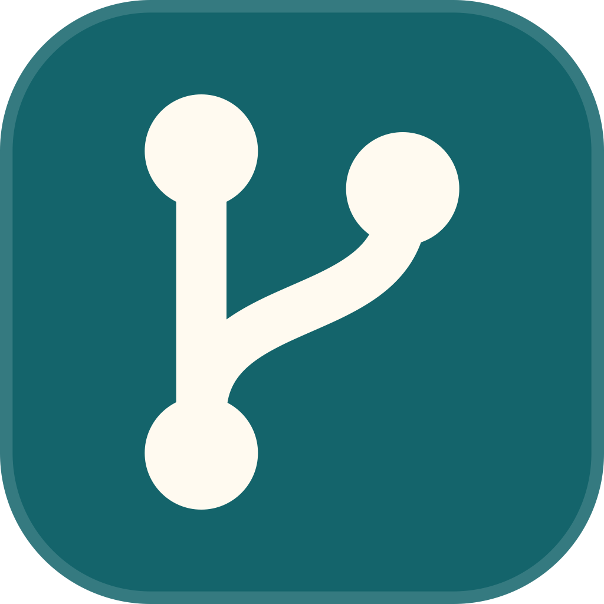

# claude-mods

Mods for [Claude Code](https://claude.com/claude-code): plugins with a hooks module that add rows to the prompt's
footer, panes beside the chat, guards on tool calls and a desktop pet. The repository is a plugin marketplace, so each
mod installs on its own.

> Mods run on Claude Code's hooks API, which is early access and may change between releases. The mods' interface is
> in Spanish; English is planned.

This is a personal project, not affiliated with or endorsed by Anthropic. Claude and its mark, which the `pet` app
shows, are Anthropic's.

## Mods

|                                                                     | Mod             | What it adds                                                                                                                  |
| ------------------------------------------------------------------- | --------------- | ----------------------------------------------------------------------------------------------------------------------------- |
|    | `bar-context`   | A footer row with the model and effort, a click switching them, the context and the cache.                                    |
|        | `bar-git`       | A footer row with the branch and pending changes, and buttons to commit them.                                                 |
|     | `bar-limits`    | The subscription's usage limits under the prompt.                                                                             |
|       | `bar-path`      | The session's folder as the footer's last row.                                                                                |
|   | `guard-commit`  | Denies commands that attribute a commit or PR to Claude, or sign one.                                                         |
|     | `guard-edit`    | Denies shell commands that write project files, so edits show their diff.                                                     |
|  | `guard-outward` | Puts pushes, gh writes, listed commands, MCP writes and built-in tools that publish or delete to a person, whatever the mode. |
|     | `guard-pnpm`    | Denies npm, npx and yarn.                                                                                                     |
|            | `pet`           | A desktop pet listing the live sessions (macOS).                                                                              |
|  | `session-title` | Titles unnamed sessions after your prompts, and again as a long one moves on.                                                 |
|    | `ui-colorify`   | Colours alerts, quotes, headings and your prompts, so what matters stands out (terminal).                                     |
|   | `ui-companion`  | A pane where a second model comments on the conversation.                                                                     |
|   | `ui-declutter`  | Folds runs of tool calls into one line (terminal).                                                                            |
|     | `ui-linkify`    | Links paths and Jira tickets, shows pasted images and runs proposed `!` commands (terminal).                                  |
|        | `ui-mods`       | A pane to turn installed and built-in mods on and off.                                                                        |

Each mod's full description is in its `.claude-plugin/plugin.json`. How the mods look and are configured is in
[DESIGN.md](DESIGN.md).

## Requirements

- A Claude Code build that loads mods (plugins with a hooks module), such as one of those below.
- `git`, for `bar-git` and `guard-edit`.
- [`jq`](https://jqlang.org/), for the images of `ui-linkify`.
- macOS with the Swift toolchain (Xcode Command Line Tools), for `pet`, which compiles the pet on first launch.

Claude Code versions every mod has passed the full gate on (`pnpm check`, which prints the version it ran with):

| Claude Code | Mods                           |
| ----------- | ------------------------------ |
| 2.1.329     | all, at their current versions |
| 2.1.330     | all, at their current versions |
| 2.1.331     | all, at their current versions |
| 2.1.332     | all, at their current versions |

## Install

At the prompt of a Claude Code terminal session, install each mod you want:

```text
/plugin install <mod> --marketplace alvaromr/claude-mods
```

Answer `y` to add the marketplace, then pick a scope.

To try a mod from a clone without installing it, start a session with its folder:

```sh
claude --plugin-dir ./<mod>
```

## Test

From the repository root, with [pnpm](https://pnpm.io/), [ShellCheck](https://www.shellcheck.net/) and, on macOS,
[SwiftLint](https://github.com/realm/SwiftLint):

```sh
pnpm install
pnpm check
```

What `pnpm check` checks, and the rest of the contributor workflow, is in [CONTRIBUTING.md](CONTRIBUTING.md).

## License

[MIT](LICENSE).
